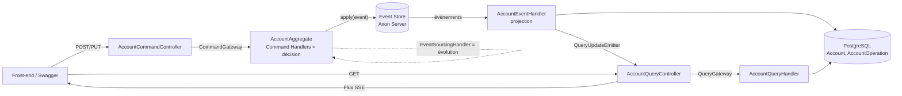
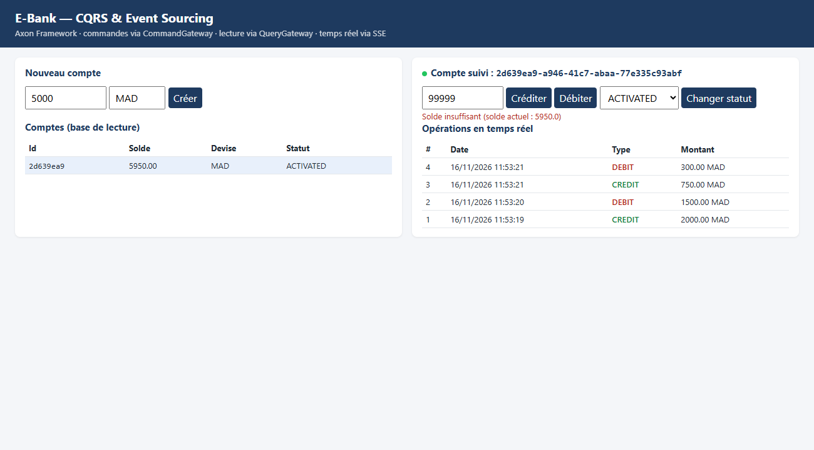
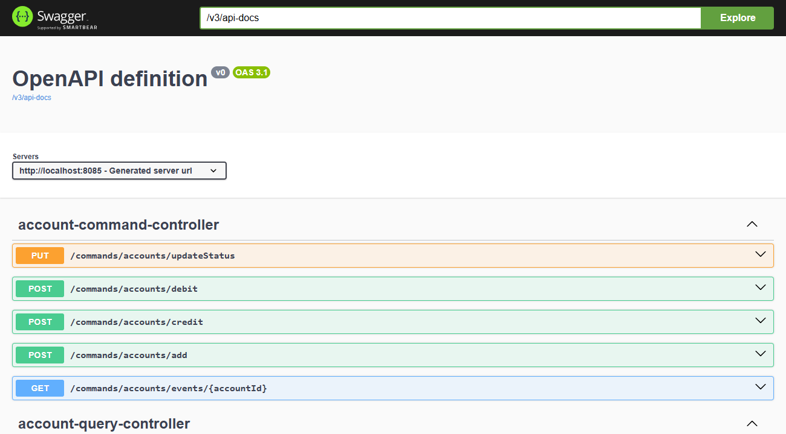
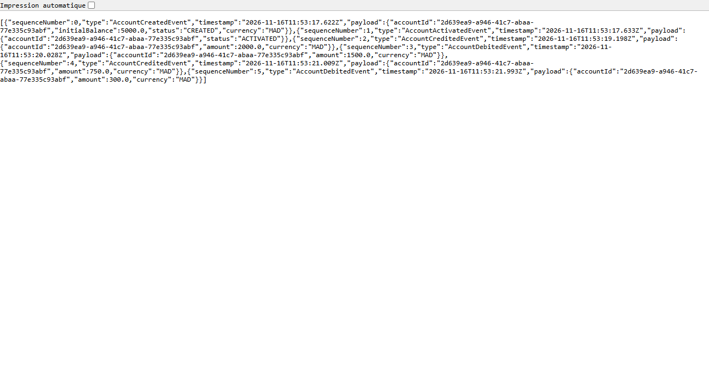
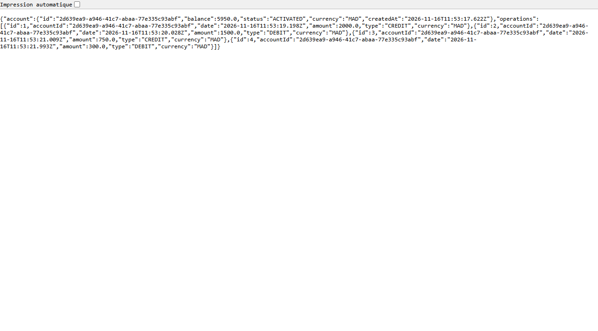
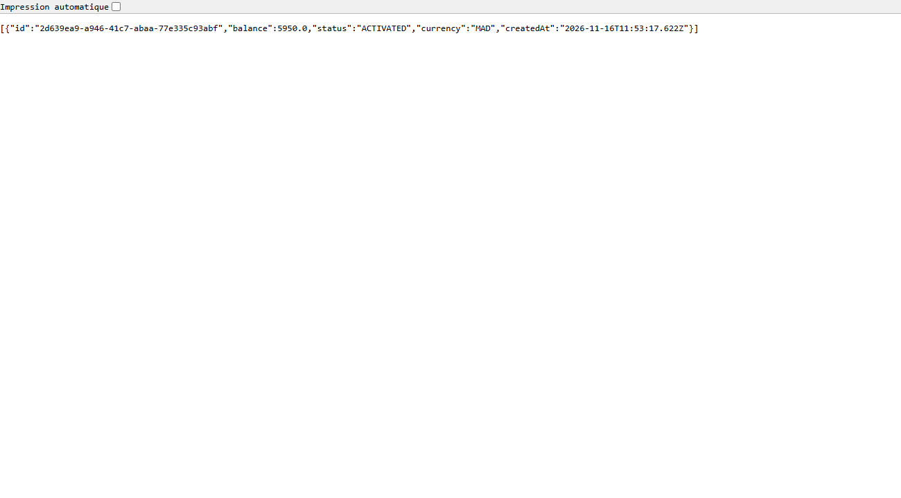

# Activité Pratique N°4 — CQRS et Event Sourcing avec Axon et Spring Cloud

**Réalisé par :** BEZZOUR Lina Malak — BDCC2
**Encadrant :** Pr. Mohamed YOUSSFI

Application de gestion de comptes bancaires basée sur les patterns **CQRS** (Command Query Responsibility Segregation) et **Event Sourcing**, avec **Spring Boot 3.5**, **Axon Framework 4.13** et **Axon Server**.

Fonctionnalités : créer un compte (activé automatiquement), créditer, débiter, changer son statut, consulter la liste des comptes et le relevé d'un compte, lire l'historique brut de l'Event Store et suivre les opérations en temps réel (SSE).

## Architecture



| Côté | Rôle |
|---|---|
| **Commande** | Les requêtes REST deviennent des commandes envoyées par le `CommandGateway`. L'agrégat vérifie les règles métier (solde initial positif, compte activé, solde suffisant, montant positif) puis émet des événements avec `AggregateLifecycle.apply()`. Son état est muté uniquement par les `@EventSourcingHandler`. |
| **Lecture** | `AccountEventHandler` (`@EventHandler`) projette les événements dans les tables JPA `account` et `account_operation`. Les requêtes passent par le `QueryGateway` et sont traitées par `AccountQueryHandler` (`@QueryHandler`), qui renvoie des DTO. |
| **Temps réel** | Endpoint `watch` qui renvoie un `Flux` (subscription query) : d'abord l'historique du compte, puis chaque nouvelle opération poussée par le `QueryUpdateEmitter`. |
| **Distribution** | Axon Server (gRPC, port 8124) sert d'Event Store centralisé et route les commandes, les événements et les requêtes. |

## Structure du code

```
ma.enset.ebankcqrses
├── commands
│   ├── controllers   AccountCommandController
│   ├── commands      AddAccountCommand, CreditAccountCommand, DebitAccountCommand, UpdateAccountStatusCommand
│   ├── dto           AddNewAccountRequestDTO, CreditAccountRequestDTO, DebitAccountRequestDTO, UpdateAccountStatusRequestDTO
│   └── aggregates    AccountAggregate
├── events            AccountCreatedEvent, AccountActivatedEvent, AccountCreditedEvent, AccountDebitedEvent, AccountStatusUpdatedEvent
├── enums             AccountStatus, OperationType
└── query
    ├── controllers   AccountQueryController (all, accountStatement, watch SSE)
    ├── entities      Account, AccountOperation
    ├── repositories  AccountRepository, AccountOperationRepository
    ├── queries       GetAllAccountsQuery, GetAccountStatementQuery, WatchEventQuery
    ├── handlers      AccountEventHandler, AccountQueryHandler
    ├── dtos          AccountDTO, AccountOperationDTO, AccountStatementResponseDTO
    └── mappers       AccountMapper
```

Les commandes, les événements et les requêtes sont des `record` Java (immuables). L'annotation `@TargetAggregateIdentifier` porte sur le composant `id` des commandes. Les payloads sont sérialisés en JSON avec Jackson (`axon.serializer.*=jackson`).

## Les étapes du TP

1. **Initialisation** : Spring Web, Data JPA, PostgreSQL, Lombok, Axon (`axon-spring-boot-starter`), SpringDoc. `axon-server-connector` est d'abord exclu dans le `pom.xml`, ce qui fait tourner Axon avec un Event Store local (JPA).
2. **Côté commande** : contrôleur, commandes, DTO, agrégat avec Command Handlers et Event Sourcing Handlers.
3. **Événements** : cinq événements, sérialisés en JSON.
4. **PostgreSQL et Docker Compose** : `docker-compose.yml` avec PostgreSQL (port hôte 5433) et PgAdmin (port 8888).
5. **Côté lecture** : entités JPA, repositories, `AccountEventHandler`, requêtes, `AccountQueryHandler`, `AccountQueryController`.
6. **SSE** : `reactor-core`, endpoint `GET /query/accounts/{id}/watch` (`text/event-stream`) et `QueryUpdateEmitter` dans les Event Handlers. Une page `index.html` affiche les opérations en direct.
7. **Axon Server** : l'exclusion est retirée, le service `axonserver` est ajouté au `docker-compose.yml` (console sur 8024, gRPC sur 8124) et `axon.axonserver.servers=localhost:8124` est configuré.

## Endpoints

| Méthode | URL | Description |
|---|---|---|
| POST | `/commands/accounts/add` | `{"initialBalance":5000,"currency":"MAD"}` → renvoie l'id du compte |
| POST | `/commands/accounts/credit` | `{"accountId":"…","amount":2000,"currency":"MAD"}` |
| POST | `/commands/accounts/debit` | `{"accountId":"…","amount":1500,"currency":"MAD"}` |
| PUT | `/commands/accounts/updateStatus` | `{"accountId":"…","status":"SUSPENDED"}` |
| GET | `/commands/accounts/events/{id}` | événements de l'agrégat lus dans l'Event Store |
| GET | `/query/accounts/all` | liste des comptes (base de lecture) |
| GET | `/query/accounts/accountStatement/{id}` | compte et ses opérations |
| GET | `/query/accounts/{id}/watch` | flux SSE des opérations en temps réel |

Swagger UI : http://localhost:8085/swagger-ui/index.html · Front : http://localhost:8085/

## Lancement

```bash
docker compose up -d          # PostgreSQL + PgAdmin + Axon Server
mvn spring-boot:run           # application sur le port 8085
```

- Console Axon Server : http://localhost:8024
- PgAdmin : http://localhost:8888 (`admin@enset.ma` / `admin`), serveur `postgres:5432`, `admin` / `1234`

**Sans Docker** (profil de test H2, Event Store JPA local) :

```bash
mvn spring-boot:run -Dspring-boot.run.arguments="--spring.profiles.active=h2 --axon.axonserver.enabled=false"
```

## Tests et captures

Scénario exécuté : création d'un compte à 5000 MAD, crédit de 2000, débit de 1500, crédit de 750, débit de 300, puis un débit de 99999 refusé.

| | |
|---|---|
| Front temps réel (SSE) |  |
| Swagger UI |  |
| Event Store d'un compte |  |
| Relevé de compte (Query Side) |  |
| Liste des comptes |  |

Règles métier vérifiées (réponses HTTP 400) :

```
débit de 99999          → {"error":"Solde insuffisant (solde actuel : 5500.0)"}
solde initial -5        → {"error":"Le solde initial ne peut pas être négatif"}
crédit compte SUSPENDED → {"error":"Le compte … n'est pas activé (statut : SUSPENDED)"}
```

Flux SSE (`curl -N /query/accounts/{id}/watch`) :

```
data:{"id":1,"accountId":"bfdd9cdf-…","date":"2026-11-16T11:45:48.686Z","amount":2000.0,"type":"CREDIT","currency":"MAD"}

data:{"id":2,"accountId":"bfdd9cdf-…","date":"2026-11-16T11:45:48.764Z","amount":1500.0,"type":"DEBIT","currency":"MAD"}
```
